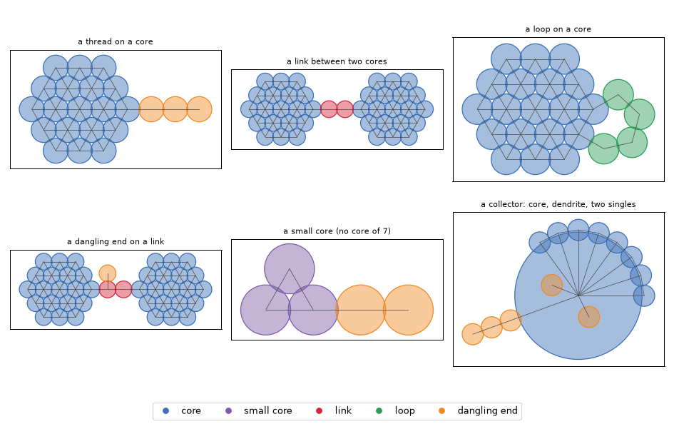
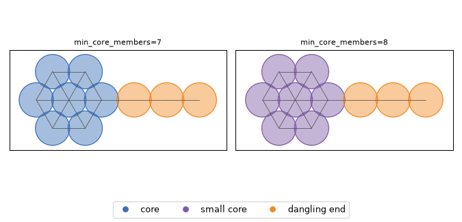

# Structure of agglomerates

Two agglomerates with the same number of particles can look very different: a compact, dense group, or a
chain that branches out like a dendrite. agglpy describes this structure from the contacts between particles:

- which parts of an agglomerate are dense (**cores**) and which are chain-like (**links**, **loops**,
  **dangling ends**);
- how far each particle lies from the agglomerate's largest particle, in contacts and in length (**branches**);
- the **longest chain** of each agglomerate.

The structure is opt-in: `analyze()` does not compute it.

```python
res = col.analyze()
s = res.with_structure()                   # new results with the structure columns; res stays as it is
s.particles.segment_type.value_counts()
s.summary(by="series", metrics="structure")
s.draw(what="particles", color_by="segment_type")
```

## The contact graph

Every particle is a node; every possible contact (the `contacts` table, see the
[methodology](methodology.md), section 6) is an edge between two nodes. Everything on this page is computed on
this graph, one agglomerate at a time. Nothing depends on the order of the rows or on the particle ids, except
where a tie is broken by the lower id (said below where it happens).

## Segments

Every particle gets one `segment_type` and one `segment_id`.



- **Core** (`core`): a dense part. A contact is *tight* when its two particles share a neighbour, i.e. they are
  two sides of a triangle. A core is a connected group of at least `min_core_members` (default 7) particles
  joined by tight contacts; triangles that share a particle belong to the same core.
- **Dangling end** (`dangling end`): a group of particles that hangs on the rest of the agglomerate by a single
  contact and holds no core particle: a thread, or a thread carrying a small loop. agglpy finds them from the
  contacts whose removal would split the agglomerate: cutting all of them leaves pieces joined like a tree, and
  the leaves of that tree are cut off again and again unless they hold a core particle.
- **Link** (`link`) and **loop** (`loop`): what is left, split into connected runs. A run touching two or more
  cores is a link; a run touching one core is a loop.
- **Small core** (`small core`): in an agglomerate without a core, its looped part (a ring, or a triangulated
  group below `min_core_members`). Its loops take the place of the core when the dangling ends are found: what
  hangs off them by one contact is a dangling end.
- **No core** (`no core`): every particle of an agglomerate with no loop at all: a tree, a pair, a single
  particle.

`segment_id` numbers the segments within an image: each core, link, loop, dangling end, small core and
no-core agglomerate is one segment, numbered from 0 by its smallest particle id. After `res.subset(...)` the
numbers keep their gaps; `subset` first and `with_structure` after numbers from 0 (the same segments).

### Choosing `min_core_members`

`min_core_members` is a choice of how to read the image, not a measurement. It is a threshold, so it has a
cliff: the same wheel of 7 particles is a core at 7 and a small core at 8.



Check your choice on your images with `s.draw(what="particles", color_by="segment_type")`, and keep it the same
for everything you compare. It is written to the export record.

## Branches

The **base** of an agglomerate is its largest particle (equal sizes: the lower id).

- `branch_depth`: the fewest contacts from the base to the particle; 0 at the base. A depth counts contacts, it
  has no unit.
- `branch_length`: the smallest sum of the diameters of the particles on a path from the base, the base not
  counted; 0 at the base. The shortest path by length may take more contacts than the shortest path by depth
  (it goes around a large particle).
- `tip`: no neighbour lies deeper; a tip ends a branch. The base is never a tip, so a single particle has none.
  Branches share their stems: `branch_count` (per agglomerate) is the number of tips.

A length sums diameters because touching spheres are `r_a + r_b` apart whatever the angle of view: each step is
exact, and the shortest path is a lower bound of the real distance.

**Collector blind spot.** On a large collector particle, every particle drawn over the collector touches it in
the image, so it reads as depth 1. A dendrite that grows toward the microscope collapses to depth 1; only what
reaches past the collector's rim shows its depth.

## Dangling ends: depth and length

On dangling-end particles, `dangling_end_depth` counts the contacts from the particle the end hangs on (that
particle not counted; the end's first particle has depth 1), and `dangling_end_length` sums the diameters from
the end's first particle. Both are NaN on every other particle.

A single particle lying on the surface of a core is a one-particle dangling end (and a branch of depth 1). On a
large agglomerate there are many of them, and they pull averages toward 1. To look at threads, leave them out
with a depth filter, as the recipe [`examples/agglomerate_structure.py`](../examples/agglomerate_structure.py)
does (`min_depth=2`).

## Longest chain

- `longest_chain`: the largest, over all pairs of particles, of the fewest contacts between them; 0 for a single
  particle.
- `longest_chain_length`: the largest, over all pairs, of the smallest sum of diameters on a path between them,
  both ends counted; a single particle: its diameter.

Both are exact at any size. The longest chain by contacts and by length can run between different particles.

## Columns

Lengths are in m in `Results` (in px in the core). The last column says what kind of number each one is in a 2D
image of a 3D agglomerate:

- **lower bound**: the true value is at least this. Overlapping circles add contacts that may not exist, and an
  extra contact can only shorten a path. Rarely broken (about 0.5 % of simulated views): true contacts dropped
  when nested circles are pruned (see the contacts table).
- **upper bound**: the true value is at most this. Extra contacts make extra triangles, so dense parts read
  larger than they are.
- **description**: neither; one extra contact can move it either way.

| table | column | unit | in 2D |
|---|---|---|---|
| particles | `segment_type` | text | description |
| particles | `segment_id` | — | label |
| particles | `branch_depth` | contacts | lower bound |
| particles | `branch_length` | m | lower bound |
| particles | `tip` | True / False | description |
| particles | `dangling_end_depth` | contacts | lower bound, where the agglomerate truly has a core |
| particles | `dangling_end_length` | m | lower bound, as above |
| agglomerates | `longest_chain` | contacts | lower bound |
| agglomerates | `longest_chain_length` | m | lower bound |
| agglomerates | `branch_count` | count | description |
| agglomerates | `branch_depth_max` | contacts | lower bound |
| agglomerates | `branch_length_max` | m | lower bound |
| agglomerates | `core_count` | count | description |
| agglomerates | `core_member_count` | count | upper bound |
| agglomerates | `small_core_member_count` | count | upper bound |
| agglomerates | `link_count` | count | description |
| agglomerates | `dangling_end_count` | count | description |
| agglomerates | `dangling_end_member_count` | count | lower bound, where the agglomerate truly has a core |
| agglomerates | `dangling_end_depth_max` | contacts | lower bound |
| agglomerates | `dangling_end_length_max` | m | lower bound |

Counts are 0 when there is none. Each `_max` is the largest value of the particle column with the same name
over the agglomerate; NaN when there is nothing to take (no branch in a single particle, no dangling end).
`branch_length_max` is the particle farthest from the base by length, which need not be a tip.

## Reading the numbers

- **Compare totals, not single agglomerates.** The labels of one agglomerate are one image's reading of it: one
  extra or missing contact can turn a link into a loop or split a dangling end. Totals over many agglomerates
  (the summary family below) are what to compare between samples.
- **False loops go one way.** Overlapping circles close loops that are not there, so thin parts can read as
  dense, never the other way round. A thread lying along the rim of a dense group reads as a loop or as part of
  the core.
- **Links between dense groups are mostly hidden:** two groups that overlap in the image close a loop around
  the link.

## Summary family `structure`

`summary(metrics="structure")` (and `summary_across_images`) gives, per group of images:

- `N_cores`, `N_links`, `N_dangling_ends`: the sums of the agglomerate counts; `N_small_cores`: the agglomerates
  with a small core;
- `core_fraction`, `small_core_fraction`, `link_fraction`, `loop_fraction`, `dangling_end_fraction`,
  `no_core_fraction`: the number fraction of the primary particles in each segment type; they add up to 1.

`summary()` without `metrics=` includes the family only on results from `with_structure()`; asking for it by
name on other results raises an error that says to call `with_structure()` first.

## The particles of a chain or a branch

Only the numbers are stored: a longest chain or a branch path is often not unique. `chain_path` returns one path
with the stored number of contacts or length, choosing among equal ones the end pair with the lower ids, then at
each step the lower id:

```python
from agglpy.core.structure import chain_path

one = s.subset(images="D7-018")
ids = chain_path(one.particles, one.contacts, agglomerate_id=3)              # the longest chain
ids = chain_path(one.particles, one.contacts, 3, by="length")                # by sum of diameters
ids = chain_path(one.particles, one.contacts, 3, to=17)                      # base to tip 17
```

It works on one image's tables. On a large agglomerate it may search once per member, so it is computed on
demand, not stored.

## Averages and ratios

Means and medians of branches and dangling ends depend on which ones count, so they are a recipe, not columns:
[`examples/agglomerate_structure.py`](../examples/agglomerate_structure.py) gives branch and dangling-end
averages with the depth filter as one visible line, the volume share beyond a depth, lengths over the diameter
of the largest particle and the fill (projected area over the circle of the largest Feret diameter).
